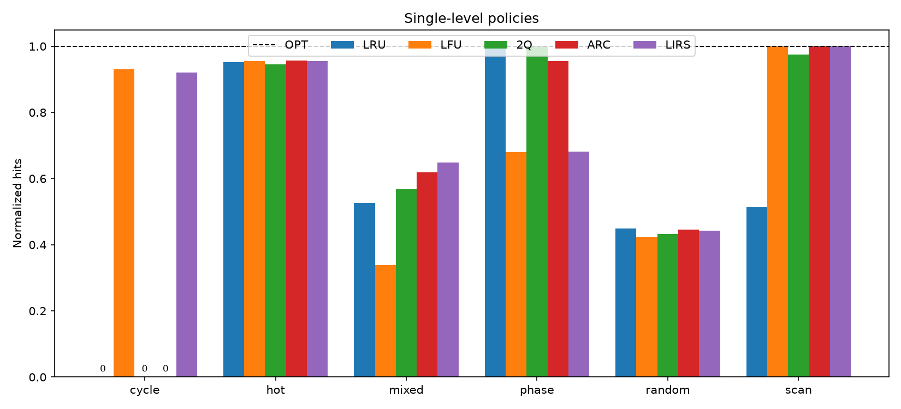
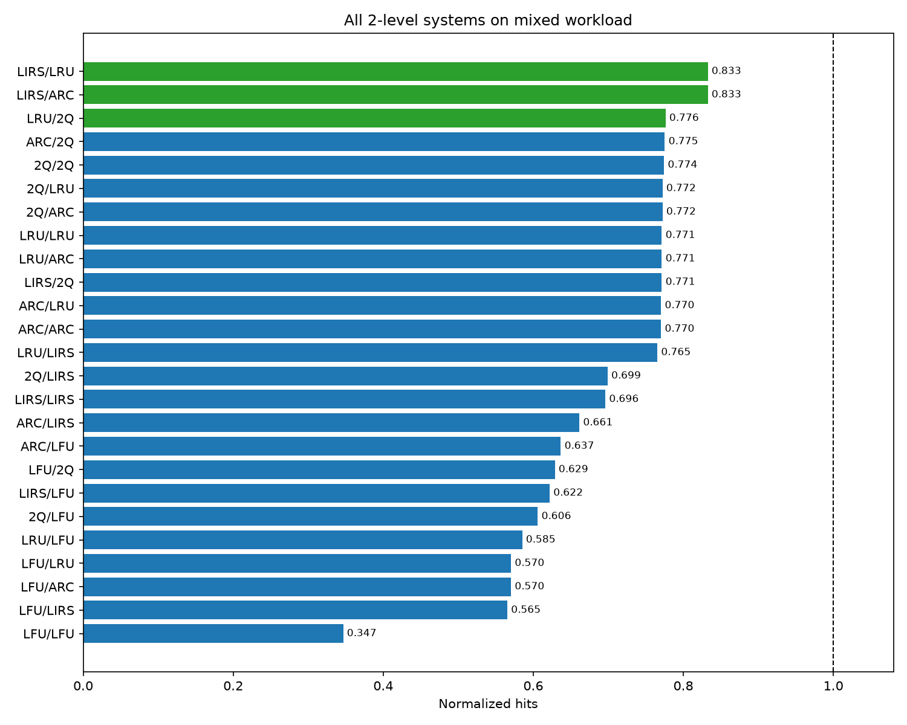
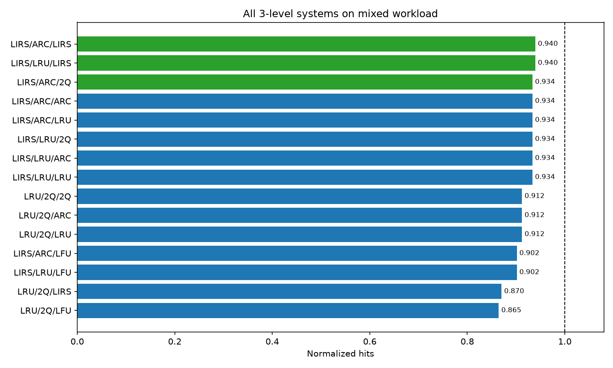
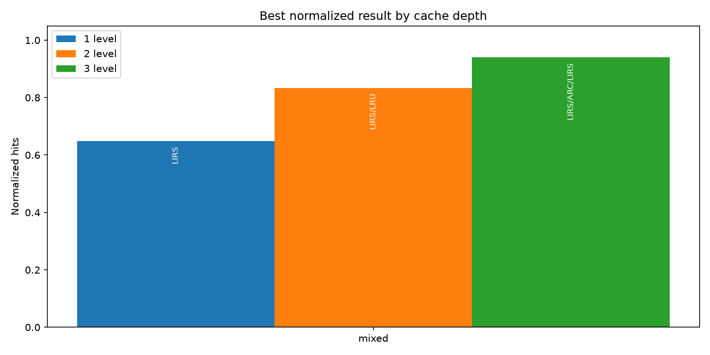
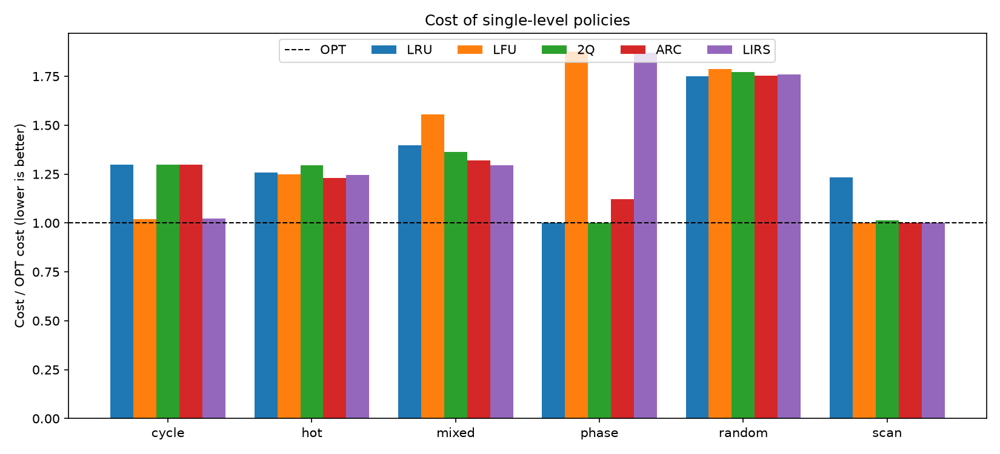
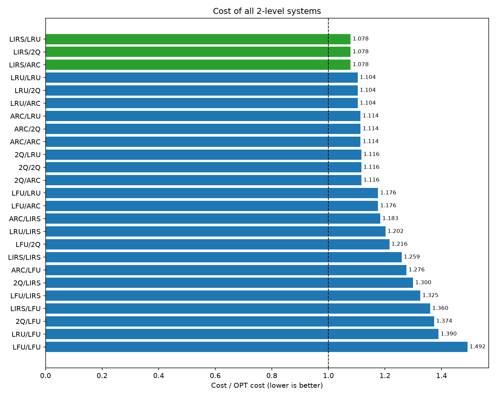
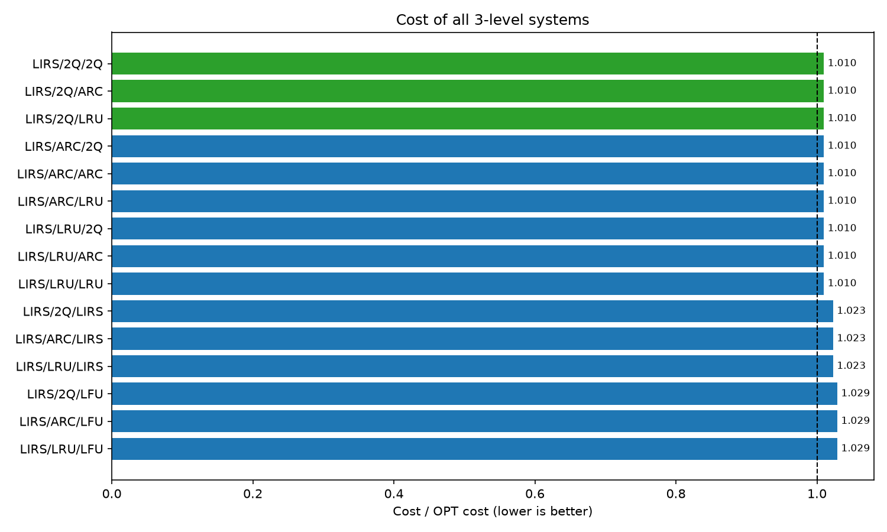
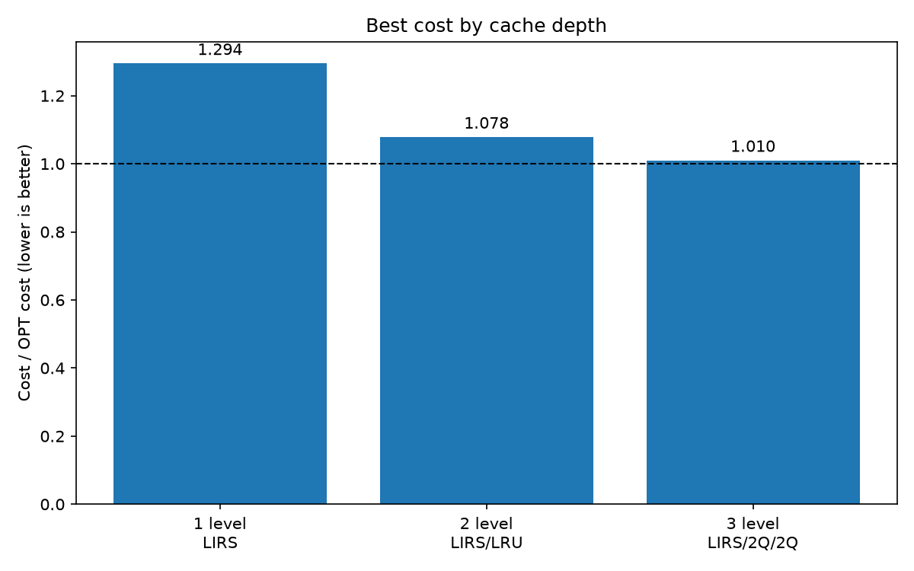

# Результаты исследования кеширования

## Методика

В эксперимент вошли политики `LRU`, `LFU`, `2Q`, `ARC` и `LIRS`. Базовая
ёмкость одного уровня равна `C = 64`, а каждая трасса содержит
`30C = 1920` запросов. Для воспроизводимости случайных последовательностей
используется seed `42`.

### Сценарии нагрузки

Одноуровневые кеши проверялись на пяти отдельных сценариях и на их
комбинации:

- `cycle` циклически перебирает рабочий набор размером `4C + 1`. Сценарий
  имитирует последовательную обработку набора, который значительно больше
  кеша, и позволяет оценить устойчивость политики к циклическому вытеснению
  полезных ключей;
- `hot` направляет 80% запросов в небольшой горячий набор размером `C/5`, а
  остальные 20% - в холодную область размером около `10C`. Это модель
  нагрузки с небольшим числом популярных объектов и длинным хвостом редко
  используемых данных;
- `scan` чередует повторные обращения к набору размером `C/4` с
  последовательным потоком новых ключей. Такая нагрузка сочетает стабильные
  часто используемые данные с просмотром больших массивов, например при
  аналитическом проходе по таблице;
- `phase` попеременно работает с двумя непересекающимися наборами размером
  `C`. Смена происходит через каждые `4C` запросов. Сценарий проверяет,
  насколько быстро политика приспосабливается к смене активной рабочей фазы;
- `random` равномерно выбирает ключи из фиксированного набора размером `4C`.
  Выраженной временной локальности здесь нет, поэтому сценарий служит
  контрольной нагрузкой для оценки поведения при слабой предсказуемости;
- `mixed` состоит из пяти равных фаз, соответствующих перечисленным типам.
  Каждый десятый запрос на всех фазах относится к одному общему горячему
  набору размером `C/4`. Комбинированная трасса одновременно проверяет
  адаптацию к смене нагрузки и удержание ключей, полезных в течение всего
  запуска.

На `mixed` проверялись все 25 двухуровневых комбинаций. Затем к каждой из
трёх лучших пар добавлялась каждая из пяти политик. Всего в трёхуровневом
эксперименте участвовали 15 кандидатов. Лидеры по числу попаданий и стоимости
отбирались независимо.

Результат нормируется по числу попаданий OPT с той же суммарной ёмкостью:

```text
normalized = policy_hits / OPT_hits
```

Для одного, двух и трёх уровней эталон имеет ёмкость `C`, `2C` и `3C`
соответственно.

## Полученные результаты

### Одноуровневые кеши

Ни одна политика не лидирует во всех отдельных сценариях: результат зависит
от характера локальности запросов.



На комбинированной трассе лучшей одноуровневой политикой стала `LIRS`:
568 попаданий против 876 у OPT (`0.648 OPT`). `LIRS` лучше остальных политик
сохраняет общий горячий набор при смене фаз.

### Двухуровневые кеши

На графике показаны все 25 комбинаций политик. Зелёным выделены три
конфигурации, на основе которых строились трёхуровневые системы.



Лучшие двухуровневые схемы `LIRS -> ARC` и `LIRS -> LRU` получили одинаковый
результат: 841 попадание против 1010 у OPT (`0.833 OPT`). Первый уровень
удерживает долгоживущие ключи, а второй принимает вытеснения из меняющегося
рабочего набора. Третье место с результатом `0.776 OPT` заняла схема
`LRU -> 2Q`, устроенная иначе.

### Трёхуровневые кеши

График включает 15 систем, полученных добавлением каждой политики к трём
лучшим двухуровневым конфигурациям.



Первое место разделили трёхуровневые схемы `LIRS -> ARC -> LIRS` и
`LIRS -> LRU -> LIRS`: 964 попадания против 1026 у OPT (`0.940 OPT`). На
последнем уровне `LIRS` долго удерживает ключи, которым не хватило места в
верхней части иерархии.

### Сравнение числа уровней

Лучшие найденные конфигурации для одного, двух и трёх уровней сопоставлены на
одном графике. Вместе с числом уровней суммарная ёмкость увеличивается от `C`
до `3C`.



*Рисунок 4 - лучшие результаты при разном числе уровней.*

## Исследование стоимости

В повторном прогоне стоимость попадания на первом, втором и третьем уровнях
равнялась `1`, `10` и `100` соответственно, а полный промах стоил `1000`.
Ёмкости уровней составляли `C`, `2C` и `4C`, поскольку медленная память в этой
модели крупнее быстрой. Итоговая стоимость делится на стоимость иерархии из
политик OPT с теми же параметрами. Эталону соответствует значение `1`; чем
меньше полученное значение, тем лучше результат.



*Рисунок 5 - стоимость одноуровневых политик на каждом сценарии.*



*Рисунок 6 - стоимость всех двухуровневых систем на `mixed`.*



*Рисунок 7 - стоимость исследованных трёхуровневых систем на `mixed`.*

Среди одноуровневых кешей лучшей осталась `LIRS` со стоимостью `1.294 OPT`.
Одинаковый результат `1.078 OPT` получили три пары: `LIRS -> 2Q`,
`LIRS -> ARC` и `LIRS -> LRU`. У трёхуровневых схем минимум `1.010 OPT`
достигнут при `LIRS` на первом уровне и любой комбинации `2Q`, `ARC` или
`LRU` на втором и третьем уровнях.

Рейтинг по стоимости отличается от рейтинга по числу попаданий. На третьем
уровне `LIRS` даёт больше всего хитов, однако не обеспечивает минимальную
суммарную стоимость. При разных размерах уровней имеют значение и число
полных промахов, и то, насколько высоко в иерархии найден запрошенный объект.



*Рисунок 8 - лучшая стоимость при разном числе уровней.*

С добавлением уровней стоимость приближается к OPT за счёт сокращения числа
дорогих полных промахов. Вместе с тем растёт и суммарная ёмкость, поэтому по
этим данным нельзя отделить влияние иерархии от эффекта дополнительной памяти.

## Вывод

В проведённом эксперименте с ростом числа уровней увеличивается число
попаданий, а комбинации разных политик работают лучше, чем повторение одной
политики. Лучший из исследованных вариантов - `LIRS -> ARC -> LIRS`.

В эксперименте по числу попаданий каждый новый уровень добавляет ещё `C`
памяти, а в эксперименте стоимости ёмкости равны `C`, `2C` и `4C`. Поэтому
результат подтверждает пользу дополнительной ёмкости и комбинации политик в
выбранных условиях.
